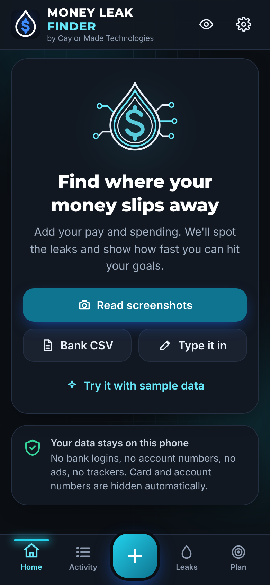
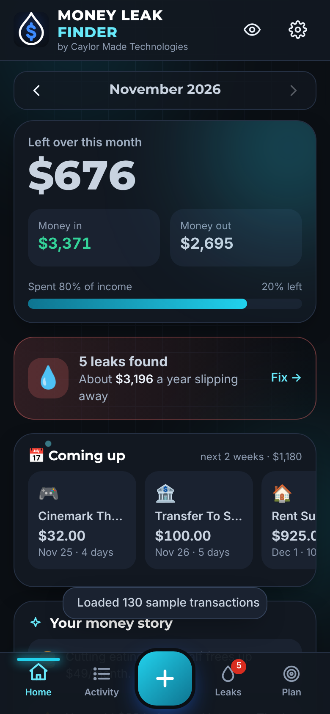
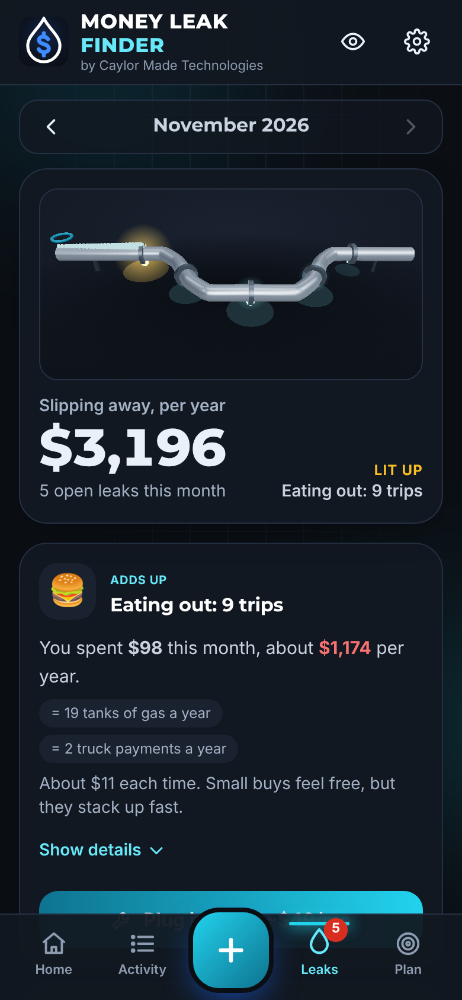
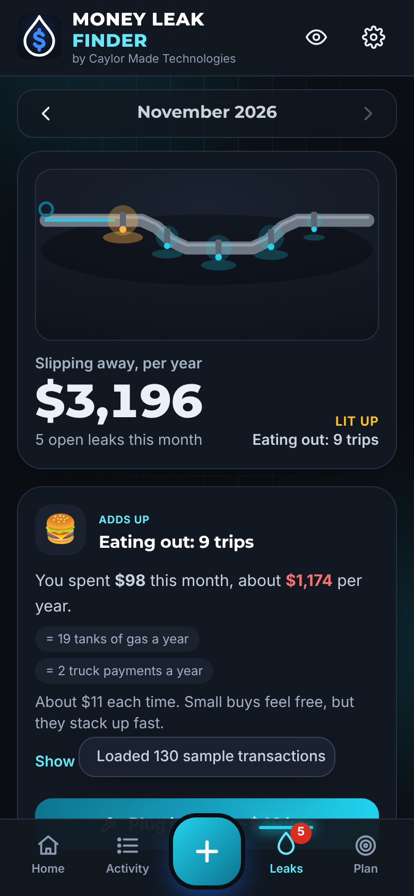

# Money Leak Finder

Find where your money slips away. A private, phone-first budgeting app (installable PWA) by **Caylor Made Technologies**.

**Live app:** https://money-leak-finder.andycaylor.workers.dev

Add your pay and spending by typing it in, uploading a bank CSV, or snapping screenshots of pay stubs, bank app lists or receipts. The app sorts everything into categories, finds the leaks, and shows how fast you can hit your goals.

<p>
  
  
  
  
</p>

## Features

| | |
|---|---|
| **Three ways to add money** | Type it in (category guessed as you type), bank CSV upload (auto-detects columns, skips duplicates), or screenshot reading with a review screen to fix mistakes before saving |
| **Auto-categorize** | 24 categories. Fix one and it remembers that merchant, and updates past ones too |
| **Dashboard** | Left over this month (count-up number), money in vs. out, income vs. spending chart, needs/wants/saving donut, spending by category, recent activity |
| **Leak finder** | Recurring subscriptions, possible double charges, small purchases that add up (fast food, gas station snacks, coffee), categories that jumped vs. last month, and fees. Each one says "You spent $X this month, about $Y per year" |
| **Where it leaks** | The Leaks screen shows a pipe run: every open leak is a joint (bigger drip = more per year), the one in focus glows amber and the flow runs toward it. Tap "Show details" on a leak to light it up. 3D on capable phones (loaded after the screen draws, ~135 KB, draws only while moving); a flat drawing of the same run without WebGL, with Reduce Motion, or on phones with ≤ 4 GB / ≤ 4 cores |
| **Plug it** | Mark a leak as plugged; the savings flow into your goals |
| **Goals planner** | Save-per-week and per-month to hit a date, time at your current leftover, how much sooner with plugged leaks, and a "what if I saved extra?" slider |
| **Invest calculator** | Monthly investing over 5/10/20/30 years at 4%, 7%, 10% example rates, with a chart, table and a clear "educational, not advice" note |
| **Money story** | Plain-English tips like "Cutting eating out in half frees up $150/month, which gets your $5,000 goal done 4 months sooner" |
| **Coming up** | Predicts recurring bills and subscriptions due in the next 2 weeks |
| **Hours of work** | Optional: enter your hourly pay and leaks show as hours of work |
| **Privacy extras** | Hide-amounts eye button, auto-blur in the app switcher, encrypted backups |
| **Feel** | Short entrance animations, swipe-to-delete with undo, confetti on wins, light haptics. Dark by default (Auto and Light in Settings). Everything respects the phone's Reduce Motion setting |

## Logo and brand

The logo follows the Caylor Made Technologies mark: a droplet drawn as parallel circuit traces (white + brand blue) with hollow solder-pad nodes, a glowing blue `$` inside, and a drip falling from the bottom. The wordmark is outlined Montserrat ExtraBold with a spaced-out second line, like the CM lockup.

| File | Use |
|---|---|
| `brand/logo-horizontal.svg` / `.png` | Full logo on dark backgrounds |
| `brand/logo-horizontal-on-light.svg` / `.png` | Full logo on white |
| `brand/logo-mark.svg` / `.png`, `logo-mark-on-light.svg` | Mark only |
| `brand/app-icon.svg`, `app-icon-1024.png` | App icon / social |
| `public/icons/` | PWA icons, favicon (bold small-size version) |

Colors: navy `#0B0F14`, brand blue `#1E6FFF` / button blue `#1B63EB`, glow blue `#3D8BFF`. Everything is generated from one source (`src/lib/brandMark.js` + `scripts/brand.mjs`): run `npm run icons` after changing it. Montserrat is embedded in the wordmark SVGs under the SIL Open Font License (`brand/Montserrat-OFL.txt`).

## Privacy and security

- **Data stays on the phone** (IndexedDB). No accounts, cookies, analytics, ads or trackers.
- **Never asks for** bank logins, full account/card/routing numbers or SSNs. Anything that looks like one is masked to the last 4 digits (SSNs are removed) on every save path: typing, CSV, screenshots and backups. A database hook re-checks every write.
- **Screenshots are read on the phone and never leave it.** The text reader (Tesseract, open source, Apache-2.0) runs inside the app in a background worker. Pictures are re-drawn on a canvas (which drops location/device data), read once, then dropped from memory. Nothing is sent and nothing is written to disk. No server, no API key, no cost.
- **Backups** can be locked with a password (AES-256-GCM, PBKDF2-SHA256 600k rounds). Restored files are fully re-validated.
- **App hardening:** strict Content Security Policy (no inline scripts or styles; `connect-src 'self'`, so the app can't talk to any other site; `'wasm-unsafe-eval'` only so the reader's WebAssembly can run), `X-Frame-Options: DENY`, HSTS, no-referrer, Permissions-Policy, frame-buster, user text never inserted as HTML, CSV export protected against spreadsheet formula injection.
- Privacy policy and terms (incl. price/refunds and business contact) are in **Settings → Privacy & terms**. There's no "OK to send" box any more because screenshots aren't sent anywhere. The policy is a template until an attorney reviews it.

## Security and legal checklist (20 points)

| # | Point | How this app handles it |
|---|---|---|
| 1 | Privacy policy | Settings → Privacy & terms, plain English |
| 2 | Terms | Same place; Texas law, Deaf Smith County |
| 3 | Refund policy | Free app, nothing to refund (stated in terms) |
| 4 | Cookie policy | Section in the privacy policy: no cookies |
| 5 | Cookie banner | Not needed: no analytics or ad pixels |
| 6 | Form consents | Nothing is collected or sent; screenshots are read on the phone (no consent box needed) |
| 7 | No unnecessary data | Only date, description, amount, category; never logins or full numbers |
| 8 | Third parties listed | None; Cloudflare only hosts the files. Fonts and the reader are bundled (licenses in `public/licenses/`) |
| 9 | Dark patterns | None; delete-all is two taps + typing DELETE |
| 10 | Hidden fees | "Free. No ads, no in-app purchases, no subscriptions." in Settings |
| 11 | Fake reviews | No reviews or testimonials |
| 12 | Unsupported claims | Estimates say "about"; invest rates labeled examples, not advice |
| 13 | Alt text | Logo and images labeled; decorative art hidden from screen readers |
| 14 | Color contrast | axe scan: 0 violations, light and dark |
| 15 | Keyboard | Skip link, visible focus ring, focus kept inside open sheets |
| 16 | Business details | Name, Hereford TX 79045, phone, email in Settings footer + policy |
| 17 | Kids' data | Adults 18+, not directed at under-13s |
| 18 | Unsubscribe | No emails sent |
| 19 | Licensed fonts/images | Inter + Montserrat (OFL, licenses included); all art drawn in-house |
| 20 | Data deletion | Delete-all button; 45-day response promise for requests |

## File structure

```
index.html                 app shell (CSP is injected at build time)
public/                    icons, theme.js (no-flash theme + frame-buster), _headers, font licenses
src/
  main.jsx, App.jsx        entry, header, animated tab screens, bottom nav with + button
  state.jsx                app state (live IndexedDB queries, month, theme, privacy, leaks)
  db.js                    Dexie database (versioned schema + upgrades) + write hooks that sanitize every transaction
  index.css                Tailwind theme on caylor-ui tokens (navy + cyan accent)
  three/                   PipeRun (drawing + lazy 3D), pipeModel (pure), pipeScene (three.js, own chunk)
  lib/motion-lite.jsx      small stand-in for the animation library (same API, ~3 KB)
  components/              UI kit (sheets, buttons, money count-up, confetti), charts, rows, forms
  screens/                 Home, Activity, Leaks, Plan (goals + invest), Settings, Add flows
  lib/                     pure logic (unit tested):
    privacy.js             masks card/account/routing numbers and SSNs
    categorize.js          merchant names + category rules
    leaks.js               leak finder + upcoming charges
    goals.js, invest.js    goal and growth math
    insights.js            plain-English tips
    csv.js, backup.js      CSV import/export, encrypted backups
    ocr.js                 on-device screenshot reader (Tesseract in a worker; loads only when used)
    ocrParse.js            text -> transactions (pay stub net pay, receipt total, bank rows), unit tested
    extract.js             checks + masks whatever was read before the review screen
worker/                    the old cloud reader (Cloudflare Worker). The app no longer uses it
scripts/ocr-assets.mjs     copies the reader files into public/ocr/ before dev/build (self-hosted, no CDN)
caylor-ui/                 shared tokens + components (copied; version in caylor-ui/VERSION)
tests/                     unit tests (node --test), incl. the v1 -> v2 database upgrade
tests/fixtures/            a database written by the v1 app (for the upgrade test)
e2e/smoke.mjs              browser test at iPhone size (Playwright + axe)
e2e/scene.mjs              upgrade in a real browser, pipe scene 3D + drawing, 320 px, screenshots
e2e/reader.mjs             the real reader on test screenshots, scored against an answer key; offline; nothing sent
e2e/make-screens.mjs       draws those test screenshots (made-up data) + answers.json
wrangler.toml              hosting config for the app (static files on Cloudflare)
```

## Run it locally

Needs Node 22.

```bash
npm install
npm run dev          # http://localhost:5173
npm test             # unit tests
npm run build        # production build in dist/
```

Screenshot reading works locally with nothing else to run: `npm run dev` copies the reader into `public/ocr/`.

Browser test (uses Playwright and Chromium):

```bash
npm run build && npx vite preview --port 4173 &
BASE_URL=http://localhost:4173/ AXE_PATH=node_modules/axe-core/axe.min.js PLAYWRIGHT_PATH=$(node -p "require.resolve('playwright')") node e2e/smoke.mjs
BASE_URL=http://localhost:4173/ node e2e/scene.mjs   # also saves docs/screenshots/after-*.png
BASE_URL=http://localhost:4173/ node e2e/reader.mjs  # screenshot reader accuracy on tests/fixtures/screens/
```

### Screenshot reader accuracy (measured)
On the 5 test screenshots in `tests/fixtures/screens/` (bank app light + dark, a pay stub, a receipt, and a low-res heavily compressed JPEG; made-up data): **27 of 27 rows fully right** (merchant, amount, date, in/out), 0 made-up rows, 1.3–1.9 s per screenshot on this test machine. These are clean renders; real screenshots and photos vary, so every row still goes through the review screen, and rows the reader wasn't sure of are flagged.
Add `?3d=1` or `?3d=0` to the URL to force the 3D pipe or the drawing.

### Saved data versions
IndexedDB schema v1 is what the app wrote at launch. v2 stores each transaction's merchant key (indexed) and adds a `meta` table; the upgrade fills the key in for existing rows and changes nothing else. `tests/migrate.test.js` runs it on a database captured from the real v1 app; `e2e/scene.mjs` does the same in a browser.

## Deploy

Runs on Cloudflare (free plan is fine).

1. **App** (the screenshot reader is part of it; nothing else to deploy):
   ```bash
   npm run build
   npx wrangler deploy        # uses ./wrangler.toml, serves dist/
   ```
2. **Old cloud reader** (`worker/`): not used by the app any more. Left deployed until you decide to delete it.
3. **Auto-deploy from GitHub:** add `CLOUDFLARE_API_TOKEN` and `CLOUDFLARE_ACCOUNT_ID` as repository secrets. Every push to `main` then tests, builds and deploys both parts (`.github/workflows/ci.yml`). Without the secrets it still runs the tests.

Bump nothing by hand for updates: the service worker auto-updates on the next visit.

## Notes

- Category and leak rules live in `src/lib/categorize.js` and `src/lib/leaks.js`; add merchants there.
- Money is stored as whole cents to avoid rounding errors.
- Fonts: Inter and Montserrat, bundled (SIL Open Font License, see `public/licenses/`).

© 2026 Caylor Made Technologies, Hereford, TX
